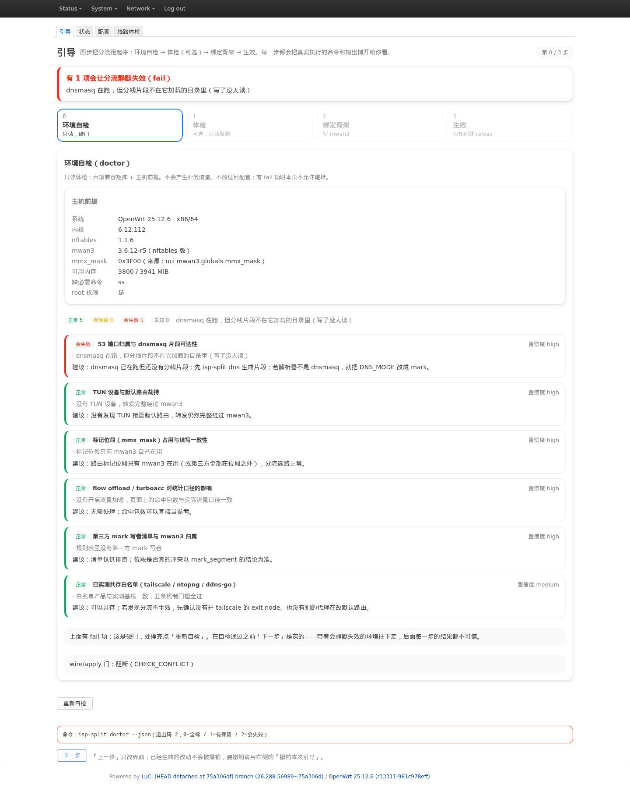
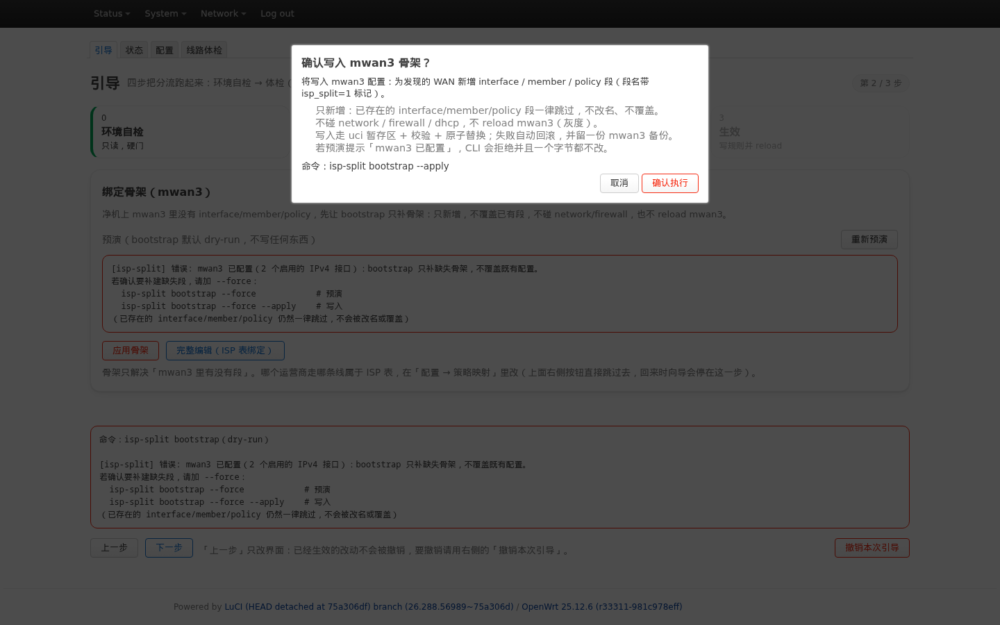
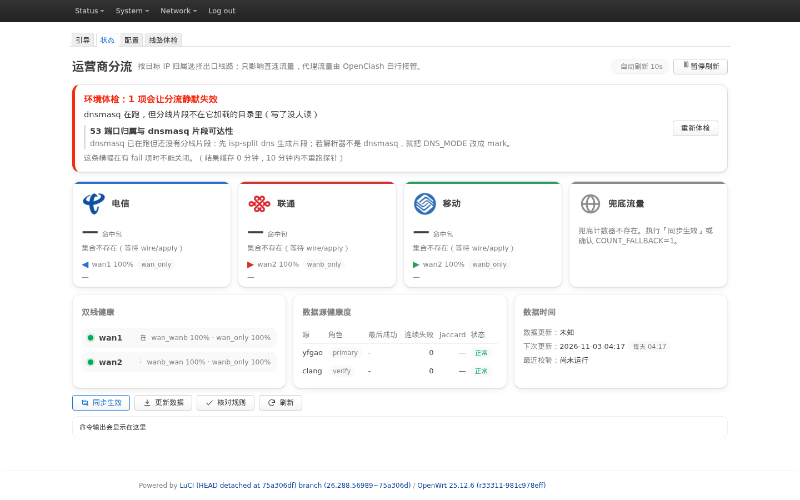
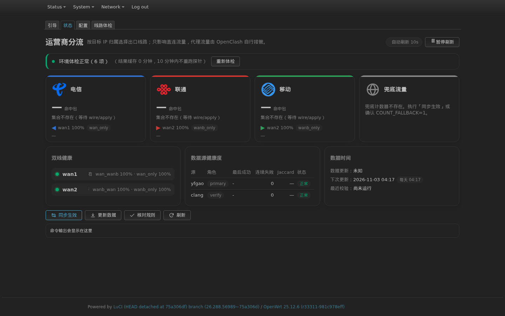
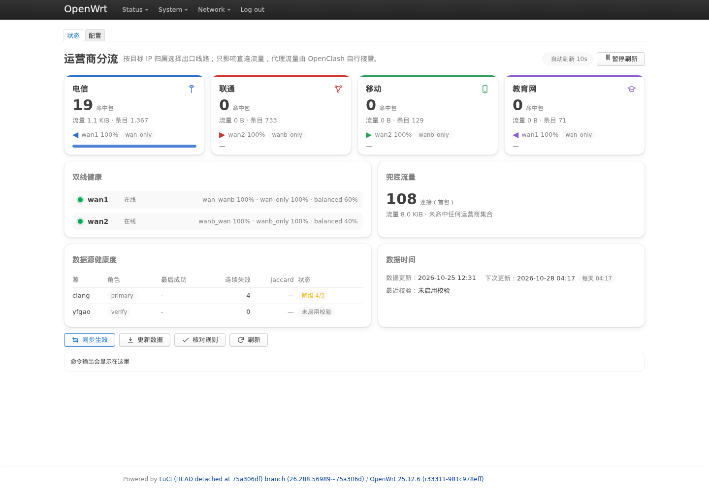
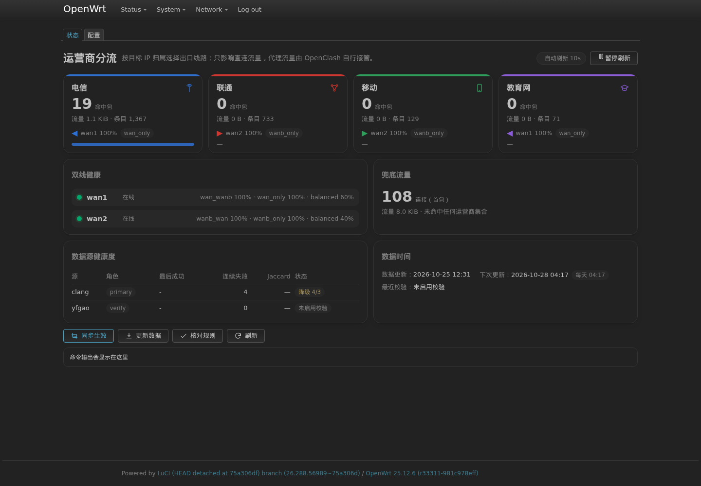
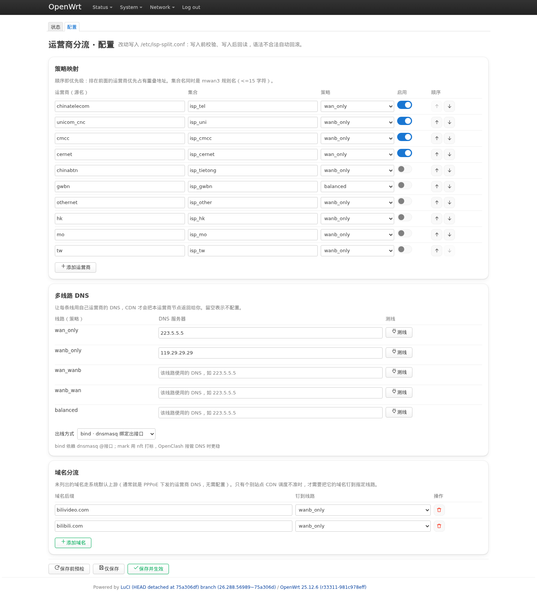
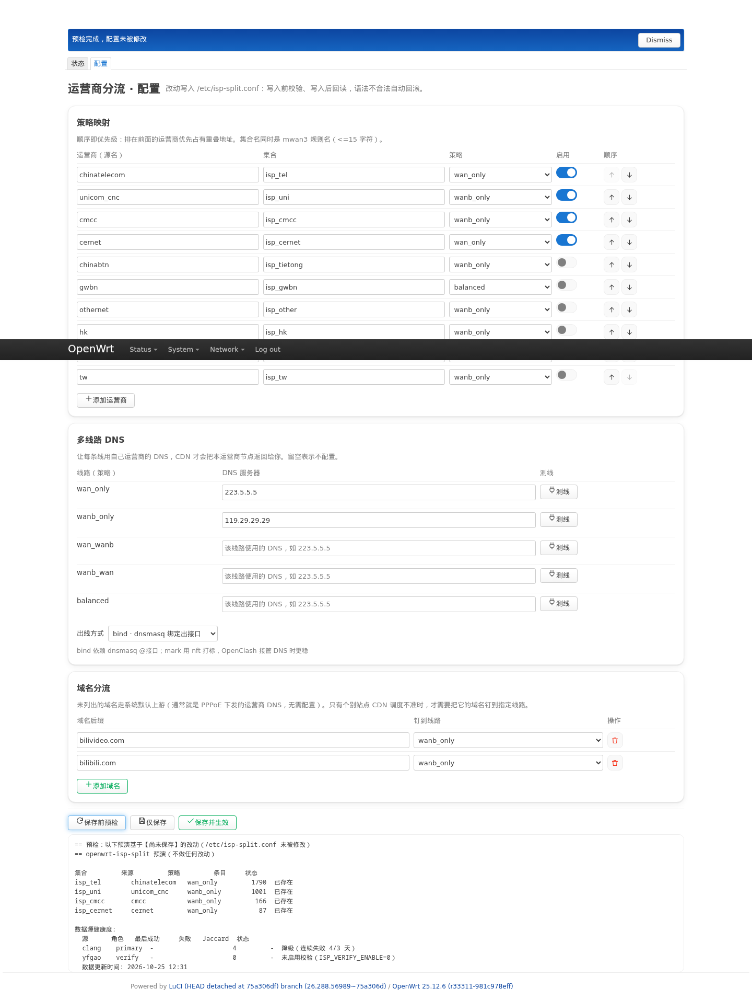

# openwrt-isp-split

按**目标 IP 归属的运营商**做 mwan3 分流。为 mwan3-nft（原生 nftables 版）设计，用 nftables 集合承载上万条国内运营商网段，每日自动跟进。

```
电信网段  ->  wan1（电信线）
联通网段  ->  wan2（联通线）
移动网段  ->  可指定线路
其余      ->  落到既有兜底规则
```

## 特性

- **运营商网段自动维护**：默认拉取并互斥化 4 类主流运营商（电信 / 联通 / 移动 / 教育网），写入 mwan3 的 nftables 集合；`ISP_TABLE` 里另有 6 类可按数据源开启
- **双源校验（0.2.1 默认开启）**：`gaoyifan/china-operator-ip`（MIT）出数据，`ispip.clang.cn` 只跑日 diff；Jaccard < 90% 时**拒绝更新并留档差异段**，校验源连续失效 3 天升级为拒绝更新，主源失效立即冻结旧数据
- **原子更新不断流**：单次 `nft -f` 事务完成集合替换，不重启 mwan3、不重建规则链
- **多线路 DNS**：域名按线路绑定 DNS 出接口，让 CDN 返回本运营商节点（bind / mark 两种模式）
- **与代理共存**：只处理直连流量，OpenClash / sing-box 的代理流量不受影响（代理先打标，`mark & 0x3f00 == 0` 判断天然互斥）
<!-- lc:begin -->
- **线路体检**：`isp-split linecheck` 逐条 WAN 检查公网/CGNAT/私网、出口 IP、同运营商目标四段延迟（DNS/TCP/TLS/首字节）、双 STUN NAT 五态、IP 归属地，给出可解释评分与一句话建议；结果缓存 60s，只读探测，不改 mwan3/nft 规则。LuCI 页面只读缓存快照、点按钮才起后台探测（`--background`），网络再差也不会白屏
<!-- lc:end -->
- **首启向导**：LuCI「引导」页四步闭环（环境自检 `doctor` → 体检（可选）→ 绑定 mwan3 骨架 `bootstrap` → 生效 `plan`/`wire`+`apply`/`sync`），进度写 `state/wizard.json`、完成后入口变「重新引导」；危险动作（写 mwan3、reload mwan3、sync、撤销）一律二次确认，失败留在本步并展开命令与输出，「撤销本次引导」先列将删除的段清单再执行 `bootstrap --rollback`
- **LuCI 界面**：卡片式状态页（运营商命中卡片 / 双线健康 / 兜底流量 / 数据源健康度 / 下次 cron；顶部一条 `doctor` 环境横幅，fail 红且不可关、warn 可折叠、全绿一行）+ 表单化配置页（上下移动排序、行内校验、保存前预检、测线按钮、只读数据源区块），深浅色与移动端自适应
- **安全设计**：三级只读预检、stage 灰度、改动前自动备份、卸载自动还原 mwan3 与 DNS 配置；配置写入前后双向校验，非法值不落盘

## 环境要求

- OpenWrt 23.05+（firewall4 / 纯 nftables）；25.12（x86_64）完整验证，其余平台见下表
- **nftables 版 mwan3 3.6.0+**：Kwrt 源内的 `mwan3-nft` 即为所需版本；上游官方源（23.05 / 24.10）的 `mwan3` 是 iptables 版，不兼容。安装前可自查：`grep -c render_config_ipsets /lib/mwan3/mwan3.sh`，结果需 ≥ 1；为 0 时请改用 Kwrt 源中的 `mwan3-nft`，或从 [dl12345/mwan3 releases](https://github.com/dl12345/mwan3/releases) 安装 nft 版
- `nftables`、`curl`；LuCI 页面为可选组件
<!-- lc:begin -->
- 线路体检另需 `socat`（UDP STUN 锁线探测）；缺失时自动降级为“NAT 未知”，不阻断其他功能
<!-- lc:end -->

## 平台验证状态

| 平台 | 状态 |
|---|---|
| OpenWrt/Kwrt 25.12（x86_64） | ✅ 完整验证（双 PPPoE 长期运行 + 自动化回归） |
| OpenWrt 24.10（x86_64） | ⚠️ **依赖不可得**——24.10 官方源只有 iptables 版 mwan3，没有 `mwan3-nft`；需自行编译 nft 版 mwan3，或直接上 25.12（本包自身可构建，但缺了 nft 版 mwan3 就没有可信的运行时结论；复核于 24.10.4 官方 packages 索引，x86_64） |
| ARM / MIPS 软路由（MT7981、IPQ 等） | ⚠️ 理论兼容（纯 shell/awk，无架构相关代码），欢迎实测反馈 |
| 官方固件直装 | ⚠️ 需先替换 iptables 版 mwan3 为 nft 版（见上方自查命令） |

> 内存参考：4 个启用集合（约 2300 元素）占内核内存约 350 kB；x86_64 全量加载约 800 ms。建议 128 MB 以上内存设备使用；更低配设备请先 `isp-split selftest` 看加载耗时。

## 安装

四种入口，按推荐顺序。全都要求 **nftables 版 mwan3 ≥ 3.6**（自查与替代方案见上方「环境要求」）。

### 1. 一键在线安装（推荐）

SSH 登录路由器（root），一条命令：

```sh
curl -fsSL https://raw.githubusercontent.com/jihebube/openwrt-isp-split/main/scripts/install-online.sh | sh
```

`raw.githubusercontent.com` 在国内常被阻断，换 jsDelivr 镜像（同一份脚本）：

```sh
curl -fsSL https://cdn.jsdelivr.net/gh/jihebube/openwrt-isp-split@main/scripts/install-online.sh | sh
```

没有 `curl` 时把 `curl -fsSL` 换成 `wget -qO-`；也可以先下载再执行（便于先读一遍脚本）：

```sh
wget -O /tmp/install-online.sh https://raw.githubusercontent.com/jihebube/openwrt-isp-split/main/scripts/install-online.sh
sh /tmp/install-online.sh
```

脚本做的事：识别 apk/opkg 与架构 → 从 GitHub Release 下载 `isp-split-<版本>.tar.gz`（默认 latest）→ 用 Release 的 `SHA256SUMS` 校验 → 完整落盘后解到 `/tmp` → 执行 `sh scripts/install.sh --all` → 打印 `isp-split --version` 与下一步。**任何一步失败都会停下并给出可读原因**（下载失败会提示换镜像），不会把半个包装上。

可用环境变量：

| 变量 | 默认 | 说明 |
|---|---|---|
| `ISP_VER` | 空（latest） | 指定版本，如 `0.4.0`；只写版本号，不带 `v`、不带 `-r1` |
| `ISP_BASE` | `https://github.com/jihebube/openwrt-isp-split` | Release 基地址；可换成可信的 GitHub 加速前缀，脚本仍会校验 `SHA256SUMS` |
| `ISP_INSECURE` | `0` | 设 `1` 跳过 TLS 证书校验（仅老固件缺 ca-bundle 时临时用） |
| `ISP_DRY_RUN` | `0` | 设 `1` 只打印将使用的 URL，不下载不安装 |
| `ISP_SKIP_INSTALL` | `0` | 设 `1` 只下载解包不安装；配 `ISP_DEST` 指定落点（默认 `/tmp/isp-split-<版本>`） |

装旧版示例（详见文末「版本切换与镜像」）：

```sh
curl -fsSL https://raw.githubusercontent.com/jihebube/openwrt-isp-split/main/scripts/install-online.sh | ISP_VER=0.4.0 sh
```

装完 LuCI 在 **网络 → 运营商分流**，升级后浏览器 `Ctrl-F5` 强刷一次。

### 2. 标准 feed（opkg / apk）

feed 由 Release 工作流自动发布到独立分支 `feed`：Release 成功后重新生成索引并强制推送该分支。raw 与 jsDelivr 两个地址等价，国内优先 jsDelivr。

**opkg（OpenWrt 24.10 及以下）**

```sh
# raw 地址
echo 'src/gz isp-split https://raw.githubusercontent.com/jihebube/openwrt-isp-split/feed' >> /etc/opkg/customfeeds.conf
# 或 jsDelivr 镜像（二选一，别同时加）
# echo 'src/gz isp-split https://cdn.jsdelivr.net/gh/jihebube/openwrt-isp-split@feed' >> /etc/opkg/customfeeds.conf

opkg update
opkg install isp-split luci-app-isp-split
```

**apk（OpenWrt 25.12+）**

apk 3 的仓库索引是 `packages.adb`，且索引必须与 `.apk` 同目录（索引里没有 Filename 字段）：

```sh
# raw 地址
echo 'https://raw.githubusercontent.com/jihebube/openwrt-isp-split/feed/apk/packages.adb' >> /etc/apk/repositories.d/customfeeds.list
# 或 jsDelivr 镜像（二选一，别同时加）
# echo 'https://cdn.jsdelivr.net/gh/jihebube/openwrt-isp-split@feed/apk/packages.adb' >> /etc/apk/repositories.d/customfeeds.list

apk update
apk add --allow-untrusted isp-split luci-app-isp-split
```

`--allow-untrusted` 是必须的：本 feed 未做 apk 签名（项目没有长期私钥），apk 会把索引标成 `UNTRUSTED`。介意签名链的用户请用第 1 种一键脚本或第 4 种本地安装。

feed 是**快照**：只保留最近一次发布的包，不保留历史版本；要装旧版请用 `ISP_VER` 一键脚本或 Release 页的 ipk/apk。OpenWrt 默认的 `/etc/opkg.conf` 没有 `option check_signature`，未签名 feed 可直接用；若你的固件手动开了这一行，feed 会被拒绝——删掉该行或改用一键脚本（不建议为了第三方 feed 全局关签名）。

### 3. iStore 手动安装（iStoreOS）

iStoreOS 是 opkg 系，用 iStore 的「手动安装」贴 ipk 直链即可。下面的链接以 v0.4.1 为例，装别的版本时把版本号与文件名一起替换（Release 页有完整文件名）。

1. iStore → **手动安装**（入口位置随 iStore 版本略有差异）
2. 粘贴主包直链：
   `https://github.com/jihebube/openwrt-isp-split/releases/download/v0.4.1/isp-split_0.4.1-r1_all.ipk`
3. 装完再贴 LuCI 包：
   `https://github.com/jihebube/openwrt-isp-split/releases/download/v0.4.1/luci-app-isp-split_0.4.1-r1_all.ipk`
4. 刷新页面，菜单 **网络 → 运营商分流**

<!-- 截图占位：iStore 手动安装入口 / 粘贴 URL 对话框 / 安装完成页；待补图后替换本注释 -->
（图文步骤截图待补：iStore 各版本入口位置不同，先按上面四步操作。）

iStore 只认 ipk；25.12 的 apk 固件请走第 1/2/4 种。

### 4. 传统下载安装

**OpenWrt 25.12+（apk 系）**：下载 Release 的 `isp-split-<版本>.tar.gz`，在路由器上解包执行安装脚本（busybox tar 不支持 `--strip-components`，解包后进目录跑）：

```sh
wget -O /tmp/isp.tgz https://github.com/jihebube/openwrt-isp-split/releases/download/v0.4.1/isp-split-0.4.1.tar.gz
mkdir -p /tmp/isp && tar -xzf /tmp/isp.tgz -C /tmp/isp
sh /tmp/isp/isp-split-0.4.1/scripts/install.sh --all
```

Release 若带 `.apk`，也可直接装（未签名）：

```sh
apk add --allow-untrusted ./isp-split-*.apk ./luci-app-isp-split-*.apk
```

**OpenWrt 24.10 及以下（opkg 系）**：

```sh
opkg install ./isp-split_*_all.ipk ./luci-app-isp-split_*_all.ipk
```

opkg 用户务必用 0.2.3 起的 ipk（容器格式已对齐官方 gzip-tar）。

### 版本切换与镜像

- **装旧版**：`... | ISP_VER=0.4.0 sh`；`ISP_VER` 只写版本号（`0.4.0`），不要写 `v0.4.0` 或 `0.4.0-r1`
- **换镜像**：脚本与 feed 优先 jsDelivr（`@main` / `@feed`）；Release 资产直链不稳时，用可信加速前缀覆盖 `ISP_BASE`。脚本会校验 `SHA256SUMS`，校验不过不会安装（校验和与包同源，主要防半截/网关替换，不构成对抗恶意镜像的信任链——请用可信镜像）
- **升级**：重复执行一键脚本即可；`/etc/isp-split.conf` 会保留，LuCI 更新后 `Ctrl-F5` 强刷
- **jsDelivr 缓存**：分支引用有缓存（通常十几分钟到数小时），刚发版看不到新包时改用 raw 或等缓存过期

## 快速开始

装好后（任选上面的安装方式）按顺序跑：

```sh
# 1. 首次安装：给 ISP_TABLE 的策略绑定 WAN 接口
isp-split init      # 交互选择；脚本用法：--bind wan_only=wan1 --bind wanb_only=wan2 --assume-yes

# 2. 预检与生效（前两步只读）
isp-split plan      # 预演：将要做哪些改动
isp-split check     # nft 干跑校验
isp-split sync      # 拉取数据并生效
isp-split verify    # 核对规则渲染

# 3. 查看分流效果
isp-split status    # 各集合命中计数与流量
```

安装后每日 04:17 自动更新数据（可用 `ISP_CRON` 修改）；以上命令纯命令行即可完成全部操作，LuCI 仅是可选便利。

卸载：`sh scripts/install.sh --uninstall` 或 `isp-split uninstall`。三条卸载路径（脚本 / 包 postrm / install.sh）走同一份清理实现 `usr/lib/isp-split/teardown.sh`：还原 mwan3 与 dnsmasq 改动、删 `isp_fallback` 计数器、删 crontab 行、删 `/etc/isp-split*` 与 LuCI 页面，卸载后不留残留。`/etc/isp-split.conf.bak.*` 历史备份默认一并删除（删除前逐条打印路径；想留档先 `cp` 走，或加 `--keep-conf-bak`：`sh scripts/install.sh --uninstall --keep-conf-bak`）。

## 引导与体检（0.4.0）

0.4.0 把两件事做成了内建功能：**净机怎么把 mwan3 骨架跑起来**（CLI `bootstrap` + LuCI 首启向导），
以及**这台机器上有没有别人会让分流静默失效**（CLI `doctor` + 状态页环境横幅）。
两者都不改分流逻辑，只是把已有命令串成一条可回退的路径。

### 1. 净机一键引导（CLI）

前提：nftables 版 mwan3（≥ 3.6）已安装，`network` 里已经有 WAN（PPPoE / DHCP / 静态都行）。
`bootstrap` 只读 `network`，一个字段都不改。

```sh
# 0）先体检：确认没有会让分流静默失效的环境问题（只读，退出码 0/1/2）
isp-split doctor

# 1）预演：默认就是 dry-run，只打印将新建的 mwan3 段，不写任何东西
isp-split bootstrap

# 2）写入骨架：为每条 WAN 补 interface + member，为 ISP_TABLE 的策略补 policy
isp-split bootstrap --apply

# 3）绑定：把每个 ISP 策略指到一条 WAN（--bind 可重复，--assume-yes 免交互）
isp-split init --bind wan_only=wan1 --bind wanb_only=wan2 --assume-yes

# 4）写规则：集合、规则块、ipset 段写进 mwan3（策略缺失/成员为空会硬失败）
isp-split wire

# 5）生效：拉数据 + 写规则 + 刷 nftables（会 reload mwan3，短暂断流 1-3 秒）
isp-split sync
```

每一步的边界：

- **只补缺失，不覆盖**：已存在的 `mwan3.<名字>` interface / member / policy 段一律跳过，
  不改名、不改 `enabled`。你手配的段（哪怕 `enabled=0` 做冷备）不会被“修正”。
- **默认拒绝已配置的机器**：mwan3 里已有 ≥2 个启用的 IPv4 接口时，`bootstrap` 直接拒绝
  （`只补缺失骨架，不覆盖既有配置`）。确实要补一个缺失的策略段时加 `--force`，它仍然只建缺失项。
- **不自动生效**：`--apply` 不跑 `init`、不 `wire`、不 reload mwan3（灰度），结束时打印下一步。
- **`track_ip` 可换**：默认 `1.0.0.1 1.1.1.1`（两个跨 AS 的 anycast），用
  `--track-ip "223.5.5.5 119.29.29.29"` 覆盖。不建议填运营商 DNS——DNS 挂了会被误判成线路 down。
- **写事务**：所有 `uci set` 先进私有暂存目录 → `uci show` 解析校验 → `rename` 原子替换正式
  `/etc/config/mwan3`，并留一份 `state/mwan3.bootstrap.<时间戳>.bak`。中途失败时正式配置一个字节都不变。

撤销：

```sh
isp-split bootstrap --rollback        # 只列清单；非交互环境直接拒绝（不改任何东西）
isp-split bootstrap --rollback --yes  # 真正删除带 isp_split=1 标记的段
```

`--rollback` 只删本项目标记（`isp_split=1`）的段，手配段一个都不动；**仍被其它策略/成员引用的段会被
保留并告警**（删了 mwan3 会渲染失败），解除引用后再跑一次即可清干净。备份文件只留档、不自动还原——
避免把你后来的手改一起回滚掉。

### 2. LuCI 首启向导

菜单「运营商分流 → 引导」是一个四步状态机；每一步都从 CLI 走，页面只负责编排与摊开命令输出：

| 步 | 标题 | 做什么 | 危险确认 |
|---|---|---|---|
| 0 | 环境自检 | `doctor --json` 的六项矩阵 + 主机前提；有 fail 项时「下一步」是灰的（硬门） | 无（只读） |
| 1 | 体检 | 点按钮触发一次线路探测；没有快照就先显示占位卡 | 无（只读探测） |
| 2 | 绑定骨架 | 「重新预演」= `bootstrap`（dry-run）；「应用骨架」= `bootstrap --apply`；ISP 表绑定深链到配置页 | ✅ 写 mwan3 前弹框 |
| 3 | 生效 | 「预演生效」= `plan`；「启用」= `wire` + `apply`；「直接同步」= `sync` | ✅ reload 断流确认 |

危险确认点的原文（确认之前不会执行任何命令）：

- **写骨架**：`确认写入 mwan3 骨架？`——逐条列出“只新增、不覆盖、不碰 network/firewall/dhcp、不 reload”，
  末尾给出命令 `isp-split bootstrap --apply`。
- **重写规则**：`确认重写规则并生效？`——写明 `会 reload mwan3：分流流量短暂中断 1-3 秒`，
  命令 `isp-split wire && isp-split apply`。
- **整链同步**：`确认整链同步？`——必须先在页面上勾选「我知道会短暂断流 1-3 秒」，「同步」按钮才可点。
- **撤销引导**：`确认撤销本次引导？`——清单不是前端猜的，来自 `bootstrap --rollback` 的真实输出
  （非交互时 CLI 打完清单即拒绝），确认后才执行 `--rollback --yes`。

引导进度写在 `/etc/isp-split/state/wizard.json`（`step` / `done` / 时间戳），刷新或重开浏览器都停在
上次那一步。四步走完后页面标题变「重新引导」：可以重走一遍，但**任何按钮都不会自动撤销已经生效的
配置**；要撤销请用页面右侧的「撤销本次引导」。「上一步」只改界面这一步，页面也这么写着。

| 第 0 步：硬门 | 第 2 步：写 mwan3 前确认 |
|---|---|
|  |  |

| 完成态：入口变「重新引导」 |
|---|
|  |

### 3. 环境体检（`isp-split doctor`）

`doctor` 回答的是“这台机器上的别人会不会让本工具静默失效”，不是“分流通不通”。它**只读**：
不发 DNS 查询、不连外网、不 STUN、不改任何配置（不碰 mwan3 / nft / uci，也不写临时文件），
所以随时可以跑，也不会把状态页上的命中计数打脏。

六项矩阵（顺序固定）：

| 项 | 检查 | 一句话 | warn 时 | fail（conflict）时 |
|---|---|---|---|---|
| 1 | `dns53_owner`<br>53 端口归属 | 谁在应答 `:53`，我们的分线片段是否落在它**真正加载**的目录里 | 53 上还有第三方解析器（mosdns 等）：分线片段可能只对部分查询生效 | 片段写在没人读的目录 / 解析器已被接管：`isp-split dns` 重写片段；或改用 mark 模式（`isp-split conf set DNS_MODE mark && isp-split dns`），让 nft 侧承担分线 |
| 2 | `tun_hijack`<br>TUN 与默认路由 | 有没有 TUN 抢走默认路由，或 `ip rule` 抢在 mwan3 前面 | 有 TUN 但默认路由没被抢：有意为之可忽略，否则关掉代理的自动路由 | 默认路由已指向 TUN：关掉 mihomo / sing-box 的 `auto-route`，或接受 IP 分流不生效 |
| 3 | `mark_segment`<br>标记位段 | 谁在写 / 读 `mmx_mask`（默认 `0x3F00`）这一段 mark | 第三方也在用，但不重叠或排在后面：可不动；想彻底消歧把它的 fwmark 移到位段外（如 `0x80000` 段） | 有程序直接改写同位段、可能选错线：把它的标记值挪开，或排到 mwan3 之后 |
| 4 | `offload_accounting`<br>offload 口径 | 软件 / 硬件流量加速对页面命中计数的影响 | 软件加速：命中只统计建连首包，看真实速率请读 `/sys/class/net/<wan>/statistics/` | 硬件加速可能连选路一起影响：先 `uci set firewall.@defaults[0].flow_offloading_hw=0` 再 `fw4 reload`，观察分流是否恢复 |
| 5 | `mark_writers`<br>第三方 mark 写者 | 规则表里谁在写路由标记、是不是 mwan3 自己（清单型，严重度继承第 3 项） | 有外来链 / iptables-nft 残留写者：按清单逐个排查 | 同第 3 项：以 `mark_segment` 的结论为准 |
| 6 | `coexist_whitelist`<br>共存白名单 | tailscale / ntopng / ddns-go 的机制门槛（每次现算）+ 版本基线 | 版本漂移（白名单按版本绑定）；或 tailscale 开了 exit node（全流量走 tailnet）、ntopng 开了 `ct acct`、ddns-go 不能绑出接口 | 一般不产生 fail；若继承第 3/4 项则复用其结论 |

读法：

```sh
isp-split doctor                     # 人读：主机前提 + 六项逐条 + 汇总 + 建议
isp-split doctor --json              # 机器读：stdout 只有一份 JSON（人类可读提示走 stderr）
isp-split doctor --profile=page      # 只跑 1/4/6（页面快照用；C1/C4 仍要读一次规则表，不是零成本）
isp-split doctor --strict            # unknown 也算“不能继续用”（退出码 1）
```

退出码：`0` 可以继续 / `1` 有保留（warn）/ `2` 有东西会静默失效（conflict）；`--strict` 把
`unknown` 也提到 1。**doctor 永不 `die`**：探针失败一律降级为 `unknown` 并记进 `probe_errors`——
“不知道”不会被当成“没问题”。

`--json` 字段：

| 字段 | 含义 |
|---|---|
| `schema` | 信封版本，当前 `1`（只有破坏性变更才进位） |
| `tool.{name,version}` | 与包版本同源 |
| `generated` / `generated_text` | epoch 秒 / 人类可读时间 |
| `profile` | `full` / `page` / `deep`（`deep` 目前与 `full` 等价） |
| `host.openwrt.{id,release,target,rev}` | `/etc/openwrt_release` |
| `host.{kernel,arch,nft,pkgmgr}` | 内核、架构、nft 版本、包管理器（`opkg` / `apk` / `none`） |
| `host.mwan3.{installed,version,nft,table,mmx_mask,mmx_mask_source}` | 是否装了 mwan3、版本、是否 nft 版、`inet mwan3` 表在不在、mark 位段及其来源（`default` / `uci mwan3.globals.mmx_mask`） |
| `host.mem.{total_kb,avail_kb,verdict}` | 内存总量 / 可用量 / 判定 |
| `host.bins.*` | 关键命令是否存在（布尔） |
| `host.root` | 是否以 root 运行 |
| `checks[]` | 六项，顺序固定：`dns53_owner` → `tun_hijack` → `mark_segment` → `offload_accounting` → `mark_writers` → `coexist_whitelist` |
| `checks[].verdict` | `ok` / `warn` / `conflict` / `unknown` |
| `checks[].status` | 同 verdict，但 `conflict` 输出为 `fail`（页面按它上色） |
| `checks[].confidence` | `high` / `medium` / `low`（由证据等级映射） |
| `checks[].facts` | 该项的原始证据（结构随检查不同） |
| `checks[].findings[].{code,verdict,detail,evidence}` | 命中项；`code` 是大写下划线稳定标识，只追加不改名 |
| `checks[].advice` | 一句话建议（页面直接显示） |
| `summary.{ok,warn,conflict,unknown,worst,blocking,headline}` | 计数 / 最差项 / 是否阻断 / 头条 |
| `gate.{can_wire,reasons[]}` | 给消费方（首启向导 / 脚本）的门：`can_wire=false` 时向导把「下一步」置灰并显示 `reasons`；`wire` / `apply` 自身仍以策略预检与 nft 校验为门 |
| `probe_errors[].{probe,cmd,note}` | 探针降级溯源，必填（空数组也要有） |
| `ms` | 本次耗时（毫秒） |

### 4. 环境横幅

状态页顶部（标题之下、运营商卡片之前）有一条 `doctor` 横幅，四种形态（体检进行中先显示一行
「正在做环境体检（doctor）…」占位）：

| 形态 | 样子 | 能不能关 |
|---|---|---|
| 有 fail（任一项 conflict） | 红条：「环境体检：N 项会让分流静默失效」+ 逐项建议 | **不能关、不能折叠**——带着会静默失效的环境看后面的数字没有意义 |
| 只有 warn | 橙条：「N 项有保留」+「查看建议 / 收起建议」 | 可折叠 |
| 无 fail / warn（全绿） | 一行「环境体检正常（N 项）」+ 绿点 +「重新体检」；若还剩 `unknown`，副标题写「最差项：unknown」 | 一行，不占地方 |
| doctor 跑不起来 | 橙条「环境体检不可用」+ 原因 +「重试」 | 不影响下方运行状态 |

结果缓存 **10 分钟**：同一份结果在页面内复用（横幅标题、汇总计数、逐项建议都来自这一次
`doctor --json` 调用），10 分钟内进出页面不重跑探针；横幅上会写「结果缓存 N 分钟，10 分钟内不
重跑探针」。点「重新体检」跳过缓存强制重跑。缓存放在浏览器 `localStorage`（隐私模式写不进去时
退化为只在内存里缓存，功能不受影响）。

| 红条（fail，不可关） | 全绿一行 |
|---|---|
|  |  |

> 两张图是两个真实状态：浅色是 doctor 报 conflict（dnsmasq 分线片段缺失），执行 `isp-split dns`
> 修好后拍的深色全绿。截图来自 OpenWrt 25.12.6 的 LuCI 真实页面。

## 界面

状态页（浅色 / 深色 / 移动端）：

| 浅色 | 深色 |
|---|---|
|  |  |

配置页（策略映射 / 多线路 DNS / 域名分流，含"保存前预检"）：

| 浅色 | 预检输出 |
|---|---|
|  |  |

移动端：移动端布局自适应（上图同源页面在窄屏下自动单列）

截图来自 OpenWrt 25.12.6 的 LuCI 真实页面。

## 工作原理

```
准备：ispip.clang.cn -> 区间化合并 -> 按优先级差集（互斥化）-> 最小 CIDR -> nftables 集合
运行：包进入 -> ip daddr @isp_tel 命中 -> jump mwan3 策略链打标 -> ip rule 选表 -> 出对应 WAN
```

- 每个连接只有首包经过规则链，后续包由 conntrack 恢复标记，稳态开销接近零
- 代理流量在更早的优先级已被标记（如 OpenClash 的 `0x162`），与本工具的掩码判断天然互斥
- 完整设计说明见 [docs/DESIGN.md](docs/DESIGN.md)

## 常用命令

| 命令 | 作用 | 改动 |
|---|---|---|
| `plan` / `check` / `selftest` | 三级预检（预演 / 干跑 / 独立表实弹） | 无 |
| `fetch` / `rollback` | 拉取 / 回滚数据 | 数据 |
| `bootstrap [--apply] [--force] [--track-ip "<ip> ..."]` / `bootstrap --rollback [--yes]` | 净机补 mwan3 骨架：默认 dry-run，`--apply` 只补缺失、不覆盖既有段；`--rollback` 只删 `isp_split=1` 段 | mwan3 |
| `doctor [--json] [--profile=page\|full\|deep] [--strict]` | 环境体检：六项兼容矩阵 + 主机前提（只读，退出码 0/1/2） | 无 |
| `init [--bind <策略>=<接口>]... [--assume-yes]` | 首次安装：发现 mwan3 接口，为 ISP_TABLE 的每个策略创建 policy/member（带 `isp_split=1` 标记） | mwan3 |
| `wire` | 把集合与规则写入 mwan3 配置（策略缺失/空成员硬失败） | mwan3 |
| `apply` | 把数据原子刷入 nftables 集合 | nft |
| `refresh` | fetch + apply（日常定时任务） | nft |
| `sync` | fetch + wire + apply（首次部署） | 全部 |
| `dns` | 生成多线路 DNS 配置 | dnsmasq |
| `status` / `health` | 集合统计 / 数据源健康度 + 双线状态 | 无 |
| `diff` | 用存档重算主源 vs 校验源的分歧（超阈值退出码 3） | 无 |
| `verify` / `probe` | 渲染核对 / 分线测速 | 无 |
| `policy-check [--json]` | 检查 ISP_TABLE 启用行的策略是否都有成员（LuCI 提示条数据源） | 无 |
| `dnstest <策略>` | 测一条线路的 DNS 是否可用 | 无 |
<!-- lc:begin -->
| `linecheck [--json] [--wan <接口>] [--force] [--background]` | 线路体检：出口类型 / 四段延迟 / NAT / 归属地 / 评分 | 无（只读探测） |
<!-- lc:end -->
| `conf check` / `conf preview` | 只校验配置 / 预演未保存的改动 | 无 |
| `export` | 导出给 mihomo / sing-box | 无 |
| `stage` / `enable` | 灰度：先注入不渲染，确认后启用 | mwan3 |
| `uninstall` | 卸载并还原 mwan3/dnsmasq 改动 | 全部 |

## 配置

主配置在 `/etc/isp-split.conf`，核心是三段：

```sh
# 运营商 -> 策略映射（第三列为 mwan3 中的 policy 名，第四列 1 启用 / 0 停用）
ISP_TABLE="
chinatelecom:isp_tel:wan_only:1
unicom_cnc:isp_uni:wanb_only:1
"

# 每条线路的 DNS 与需要钉到线路的域名后缀
DNS_TABLE="wan_only:223.5.5.5 wanb_only:119.29.29.29"
DOMAIN_SPLIT="bilivideo.com:wanb_only"
```

生效方式：策略映射改动执行 `isp-split wire && isp-split apply`；DNS 改动执行 `isp-split dns`；也可在 LuCI 配置页操作。完整字段说明见 [docs/CONFIGURATION.md](docs/CONFIGURATION.md)。

<!-- lc:begin -->
线路体检的开关与隐私：

```sh
LINE_CHECK_ENABLE=1          # 总开关；0=完全不执行体检
LINE_CHECK_GEO=1             # 1=允许把出口公网 IP 发给第三方查归属地；0=只关闭归属地查询
LINE_CHECK_GEO_PROVIDER=auto # auto | baidu | ip-api | off
LINE_CHECK_MIN_INTERVAL=60   # 结果缓存/手动触发最小间隔（秒）
```

关闭归属地只停止归属地查询；出口 IP 回显（api.ipify.org / icanhazip.com）、
STUN（4 台）与同网/基线延迟探测仍会照常发出。卡片显示“未查询”；省/市不可知，
但仍会用本地 `@isp_*` 集合判断运营商大类。要完全停发体检请求，请设
`LINE_CHECK_ENABLE=0`。完整字段与隐私说明见
[docs/CONFIGURATION.md](docs/CONFIGURATION.md#线路体检line_check_)。
<!-- lc:end -->

多数据源（0.2.1 默认双源：yfgao 主源 + clang 校验源）：

```sh
ISP_SOURCES="
yfgao:primary:https://china-operator-ip.yfgao.com
clang:verify:https://ispip.clang.cn
"
ISP_SOURCE_FILES="
yfgao:chinatelecom=chinanet,unicom_cnc=unicom,cmcc=cmcc,cernet=cernet
clang:chinatelecom=chinatelecom,unicom_cnc=unicom_cnc,cmcc=cmcc,cernet=cernet
"
ISP_VERIFY_ENABLE=1   # 校验源只跑日 diff；分歧超阈值会拒绝更新（退出码 3）
```

`ISP_SOURCES` 留空 = 与 0.1.x 完全一致的单源行为，老配置无需改动。
升级时已有 `/etc/isp-split.conf` 会被保留：显式声明过 `ISP_SOURCES` 的配置
（例如 clang 主源 + `ISP_VERIFY_ENABLE=0`）不会被自动切换。

yfgao 只有 `chinanet/unicom/cmcc/cernet` 四类；`ISP_TABLE` 里的
`chinabtn/gwbn/othernet/hk/mo/tw` 默认关闭，原因见
[docs/CONFIGURATION.md 的「多数据源」一节](docs/CONFIGURATION.md#多数据源v021-默认双源)。

## 文档

| 文档 | 内容 |
|---|---|
| [docs/CONFIGURATION.md](docs/CONFIGURATION.md) | 配置详解：策略映射、多线路 DNS、域名分流、兜底行为 |
| [docs/DIAGNOSIS.md](docs/DIAGNOSIS.md) | 兜底计数增量归因：DNS 到底会不会被计入、怎么只读对账 |
| [docs/BUILDING.md](docs/BUILDING.md) | 构建：ipk（零依赖）、apk（Docker / 原生 SDK）、CI、发布 |
| [docs/FIRMWARE.md](docs/FIRMWARE.md) | 编译进自编译固件（buildroot / ImageBuilder） |
| [docs/DESIGN.md](docs/DESIGN.md) | 设计与原理：数据管线、与代理共存、与商业方案对比 |
| [docs/SECURITY.md](docs/SECURITY.md) | 安全模型：ACL 授权面、渲染链、`doctor` 六项矩阵与安全审计的关系 |

## 与 iKuai（爱快）的对比

| 能力 | iKuai（商业） | 本项目 |
|---|---|---|
| 运营商网段分流 | ✅ | ✅ 默认 4 类主流运营商（可扩到 10 类），每日自动更新 |
| 多线路 DNS | ✅ | ✅ bind / mark 双模式，兼容代理接管 DNS |
| 域名 / 设备钉线 | ✅ | ✅ `DOMAIN_SPLIT` + mwan3 源地址规则 |
| 灰度 / 预演 / 回滚 | 部分 | ✅ 三级预检 + stage 灰度 + 一键还原 |
| 数据源质量校验 | ❌ | ✅ 主源 + 校验源日 diff（Jaccard 阈值 + 差异段留档） |
<!-- lc:begin -->
| 线路体检 / NAT 判定 | 部分 | ✅ 出口类型、四段延迟、五态 NAT、归属地、可解释评分（不做 NAT1-4 细分） |
<!-- lc:end -->
| 开源可审计 | ❌ | ✅ MIT，纯 shell + awk，无黑盒 |
| DPI 应用识别选线 | ✅ | ❌ 见下方说明 |

**已追平**：运营商分流、多线路 DNS、域名/设备级钉线——日常"电信走电信、联通走联通、CDN 调度正确"的使用体验与 iKuai 一致。

**唯一差距**：DPI 应用识别。开源侧（netifyd/nDPI、eBPF 方案等）目前无法把识别结果接入多 WAN 路由——DPI 要看多个包才敢下结论，而路由必须在连接首包打标，时序上矛盾。替代方案：把大流量应用的 CDN 域名加入 `DOMAIN_SPLIT` 钉线（域名即应用本体，比 DPI 更精准），配合 mwan3 按设备分线，可覆盖按应用调度的大部分收益。完整分析见 [docs/DESIGN.md](docs/DESIGN.md)。

## 安全模型与已知边界

完整的授权面、信任边界与回归防线见 [docs/SECURITY.md](docs/SECURITY.md)。三条最常被误解的先写在前面：

1. **LuCI ACL 的 `write` = 以 root 执行任意 `isp-split` 子命令**。rpcd 只按可执行文件路径授权，不按子命令细分；默认安装只有 root 拥有该 ACL，不要把它授给“受限运维”账号。`read` 能读 `/etc/isp-split.conf` 与整个 `state/` 树（含公网 IP、归属地、STUN 映射）。0.3.3 起 `write` 另有一个**单文件**写权限 `/etc/isp-split/state/wizard.json`（首启向导进度）；向导按钮侧的 argv 白名单只是前端约束，不是 ACL 边界——详见 [docs/SECURITY.md](docs/SECURITY.md) §1.1。
2. **外网文本不会变成 HTML**。归属地、回显 IP、STUN 详情等全部经 `_lc_json_esc` 落盘，LuCI 侧只用 `E()` 文本节点渲染；全文唯一的 `innerHTML` 是静态图标 SVG，不接受 JSON 字段。`AUDIT-SECURITY-v2` §A-15 的结论是当前链路不可利用，selftest 已加“伪造全字段 payload”回归断言。
3. **`uninstall` 的 BASE 有硬守卫**。`ISP_SPLIT_BASE=/etc isp-split uninstall` 会被拒绝；真实根只接受默认 `/etc/isp-split`，其它目录必须显式 `--i-know-what-im-doing`。`export` 的 README/数据文件统一走同目录临时文件 + 原子 `rename`，不写穿符号链接。

## 已知限制

1. **与 OpenClash fake-ip 模式不兼容**：fake-ip 给域名返回假 IP（198.18.0.0/15），本工具按真实目标 IP 匹配运营商集合，fake-ip 下分流与多线路 DNS 均不生效（启动检测会告警）。请使用 redir-host 模式（新版 OpenClash 默认）。
2. 只处理直连流量；代理流量的出口由代理自身决定
3. CDN 调度依赖 DNS 解析路径，国内域名应走本地 dnsmasq 而非代理远程解析
4. 数据来自 BGP/AS_PATH（yfgao）与 IPNetDB/WHOIS（clang）等公开记录，个别骨干段归类有误差
5. 稳态性能开销接近零；每日一次全量加载约 800 ms、典型 4 个启用集合约 2300 个元素（x86_64 实测示例，实际随数据源与启用项变化）
6. `wire` 仍以文本级拼接写入 `/etc/config/mwan3`，但已有三重防护：锚点缺失直接报错（不会追加到链尾）、新文件先放临时目录用 UCI 解析校验、校验通过后原子覆盖并保留备份。在 LuCI 保存过 mwan3 后仍需重跑 `isp-split wire && isp-split apply`
7. 更新源的 IP 可能落在某个集合里，该线路故障时 `fetch` 会失败
8. 启用 `othernet` 集合会把公共 DNS 一并分走，该线路故障时导致解析失败（默认关闭）
9. mwan3 原生的「域名 -> nftset」需要 dnsmasq-full（`no-nftset` 的基础镜像不支持）；本工具的多线路 DNS 不受此限制
10. 兜底流量由 mwan3 的 `default_rule_v4` 决定：**缺省即启用**（mwan3 对 rule 的 `enabled` 缺省=启用）；只有显式禁用或删除该规则时，兜底流量才走系统默认路由（`status` 会提示）
11. 默认主源 yfgao 只提供 `chinanet/unicom/cmcc/cernet` 四类；`ISP_TABLE` 中的
    `chinabtn/gwbn/othernet/hk/mo/tw` 默认关闭。要启用这些分类，需要换用提供对应文件的
    主源（例如把 clang 配成 primary），否则 `fetch` 会明确报缺文件
<!-- lc:begin -->
12. 线路体检的 NAT 判定只给「公网 / 锥形 / 对称或多出口 / CGNAT / 未知」五态，
    **不是 NAT1-4 认证**：公网 STUN 服务器基本不支持 `CHANGE-REQUEST`，无法可靠区分
    Full Cone / Restricted / Port-Restricted。UDP 3478 被运营商阻断时只降级为“未知”，
    不影响其他检查项与评分
13. 归属地查询会把每条 WAN 的出口公网 IP 发给第三方（默认只走百度 HTTPS）；
    只发送出口 IP，不发送内网地址、设备名、MAC 或流量内容。`ip-api` 仍是可选的
    显式配置项，但它使用 HTTP 明文；介意时把 `LINE_CHECK_GEO` 设为 `0`，或不要
    把 `LINE_CHECK_GEO_PROVIDER` 设为 `ip-api`
<!-- lc:end -->

## 路线图

- [x] **0.2.1**：主源切到 `gaoyifan/china-operator-ip`（MIT），默认 `ISP_VERIFY_ENABLE=1`，
      校验源换 clang；`sources.tsv` 残留清理、LuCI 只读数据源区块
<!-- lc:begin -->
- [x] **0.3.0**：线路体检正式发货——逐条 WAN 的出口类型五态（公网 / 锥形 / 对称或多出口 /
      CGNAT / 未知）、出口 IP 与多层 NAT、DNS/建连/TLS/首字节四段延迟、双 STUN、
      归属地（默认开、可关）、可解释评分与一句话建议、60s 缓存；LuCI 卡片页只读缓存，
      点按钮才起后台探测
<!-- lc:end -->
- [x] **0.4.0**：净机一键引导 `bootstrap`（只补缺失骨架 + 原子写 + `--rollback`）、
      环境体检 `doctor`（六项兼容矩阵 + `--json`）、LuCI 首启向导（四步状态机 + 危险确认）、
      状态页环境横幅（fail 不可关 / warn 可折叠 / 10 分钟缓存）
- [ ] IPv6 支持
- [ ] LuCI 内集成 `probe` 分线测速与自动纠偏
- [ ] 多格式域名清单导出（smartdns / AdGuard Home）

## 反馈与适配

- 平台兼容问题（ARM/MIPS、非 Kwrt 固件）请开 issue 并附：`sh tools/router-preflight.sh` 输出、`nft --version`、内存大小
- 数据源归属误差请到对应项目反馈（主源 [gaoyifan/china-operator-ip](https://github.com/gaoyifan/china-operator-ip)、
  校验源 [ispip.clang.cn](https://ispip.clang.cn)），本仓库只负责分流逻辑
- 欢迎提交 PR；shell 请保持 busybox ash 兼容（禁止 bash 专属语法），改动请跑 `sh tools/selftest.sh`

## 致谢

站在这些项目的肩膀上，感谢：

| 项目 | 贡献 |
|---|---|
| [OpenWrt](https://openwrt.org) & [LuCI](https://github.com/openwrt/luci) | 本项目生存的土壤——所有运行时框架（uci / rpcd / ubus / LuCI view API）都来自它们 |
| [dl12345/mwan3](https://github.com/dl12345/mwan3)（mwan3-nft） | **本项目的基石**。nftables 原生的多 WAN 策略路由，`render_config_ipsets` + `loadfile` 机制让“1.3 万条网段交给 mwan3 自动管理”成为可能——没有它就没有这个项目 |
| [gaoyifan/china-operator-ip](https://github.com/gaoyifan/china-operator-ip) | 默认主数据源。BGP AS_PATH 口径的运营商网段分类，MIT 许可，每日 GitHub Actions 自动更新 |
| [ispip.clang.cn](https://ispip.clang.cn)（[@clangcn](https://github.com/clangcn/everyday-update-cn-isp-ip)） | 默认校验数据源，每日更新的运营商 CIDR。作为第二意见与主源交叉验证 |
| [felixonmars/dnsmasq-china-list](https://github.com/felixonmars/dnsmasq-china-list) | 外部域名清单的兼容格式来源（`DOMAIN_LIST_DIR` 直接吃它的 `server=/域名/` 格式） |
| [misakaio/chnroutes2](https://github.com/misakaio/chnroutes2) | `audit` 角色数据源（每小时更新的中国全网宣告段，可用于月度边界体检） |

以及所有提交 issue、在非 x86 平台做实测反馈、帮忙传播的朋友们——分流工具的正确性最终要靠真实网络来验证。

## 许可

本仓库代码 [MIT](LICENSE)。数据来源的许可红线：

| 源 | 许可 | 分发 |
|---|---|---|
| [gaoyifan/china-operator-ip](https://github.com/gaoyifan/china-operator-ip)（默认主源） | **MIT** | ✅ 可随固件/ipk 分发 |
| [ispip.clang.cn](https://ispip.clang.cn)（默认校验源） | **无许可证**，仅免责声明 | ❌ 只做运行时下载，仓库与包内**不含**任何 clang 数据 |

安装包与仓库只带配置模板，所有运营商数据都由设备运行时下载；不要把自己抓下来的
`/etc/isp-split/data/*.txt` 打包分发。mwan3-nft 基于 [dl12345/mwan3](https://github.com/dl12345/mwan3)。
