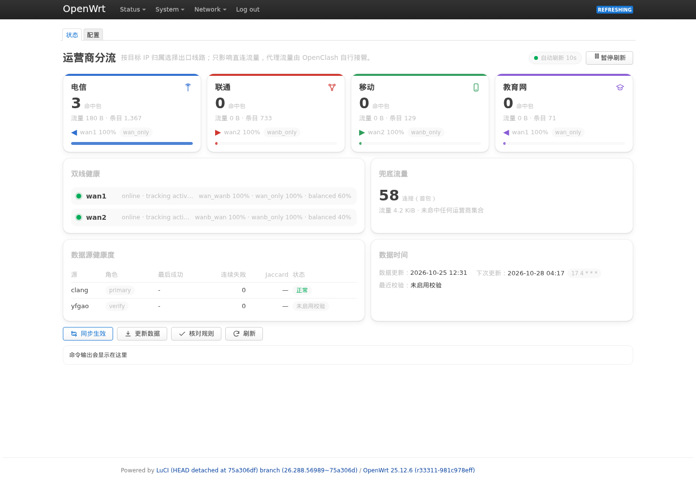
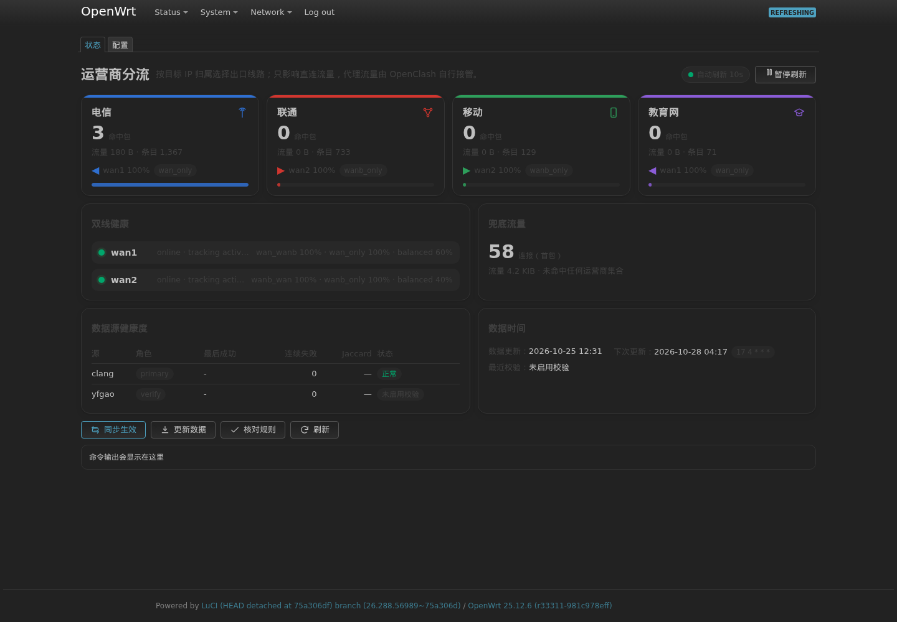
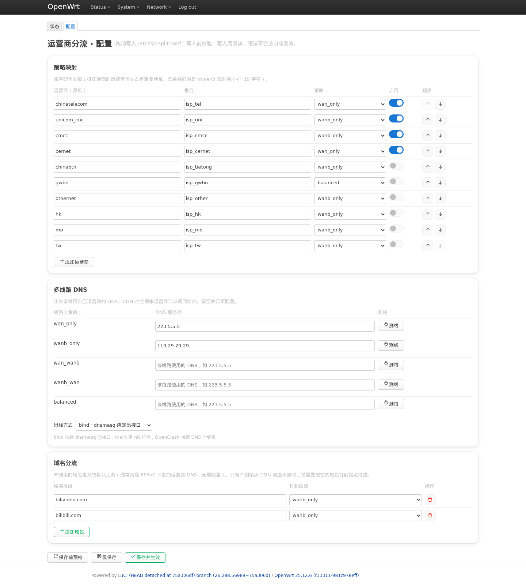
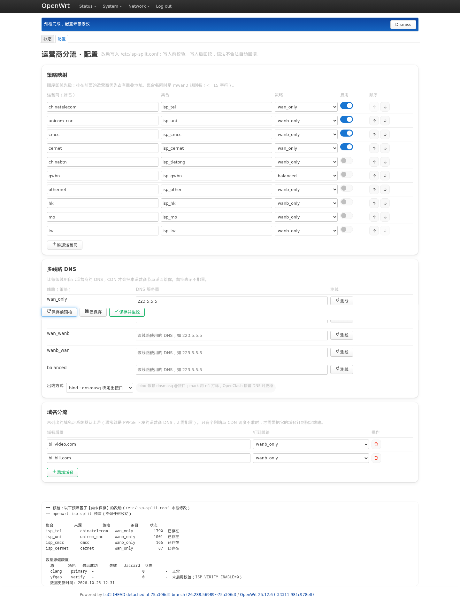

# openwrt-isp-split

按**目标 IP 归属的运营商**做 mwan3 分流。为 mwan3-nft（原生 nftables 版）设计，用 nftables 集合承载上万条国内运营商网段，每日自动跟进。

```
电信网段  ->  wan1（电信线）
联通网段  ->  wan2（联通线）
移动网段  ->  可指定线路
其余      ->  落到既有兜底规则
```

## 特性

- **运营商网段自动维护**：默认拉取并互斥化 4 类主流运营商（电信 / 联通 / 移动 / 教育网），写入 mwan3 的 nftables 集合；`ISP_TABLE` 里另有 6 类可按数据源开启
- **双源校验（0.2.1 默认开启）**：`gaoyifan/china-operator-ip`（MIT）出数据，`ispip.clang.cn` 只跑日 diff；Jaccard < 90% 时**拒绝更新并留档差异段**，校验源连续失效 3 天升级为拒绝更新，主源失效立即冻结旧数据
- **原子更新不断流**：单次 `nft -f` 事务完成集合替换，不重启 mwan3、不重建规则链
- **多线路 DNS**：域名按线路绑定 DNS 出接口，让 CDN 返回本运营商节点（bind / mark 两种模式）
- **与代理共存**：只处理直连流量，OpenClash / sing-box 的代理流量不受影响（代理先打标，`mark & 0x3f00 == 0` 判断天然互斥）
- **LuCI 界面**：卡片式状态页（运营商命中卡片 / 双线健康 / 兜底流量 / 数据源健康度 / 下次 cron）+ 表单化配置页（上下移动排序、行内校验、保存前预检、测线按钮、只读数据源区块），深浅色与移动端自适应
- **安全设计**：三级只读预检、stage 灰度、改动前自动备份、卸载自动还原 mwan3 与 DNS 配置；配置写入前后双向校验，非法值不落盘

## 环境要求

- OpenWrt 23.05+（firewall4 / 纯 nftables）；25.12（x86_64）完整验证，其余平台见下表
- **nftables 版 mwan3 3.6.0+**：Kwrt 源内的 `mwan3-nft` 即为所需版本；上游官方源的 `mwan3` 是 iptables 版，不兼容。安装前可自查：`grep -c render_config_ipsets /lib/mwan3/mwan3.sh`，结果需 ≥ 1；为 0 时请改用 Kwrt 源中的 `mwan3-nft`，或从 [dl12345/mwan3 releases](https://github.com/dl12345/mwan3/releases) 安装 nft 版
- `nftables`、`curl`；LuCI 页面为可选组件

## 平台验证状态

| 平台 | 状态 |
|---|---|
| OpenWrt/Kwrt 25.12（x86_64） | ✅ 完整验证（双 PPPoE 生产环境长期运行 + VM 回归） |
| OpenWrt 24.10（x86_64） | ✅ CI 双 SDK 构建，未真机长测 |
| ARM / MIPS 软路由（MT7981、IPQ 等） | ⚠️ 理论兼容（纯 shell/awk，无架构相关代码），欢迎实测反馈 |
| 官方固件直装 | ⚠️ 需先替换 iptables 版 mwan3 为 nft 版（见上方自查命令） |

> 内存参考：4 个启用集合（约 2300 元素）占内核内存约 350 kB；x86_64 全量加载约 800 ms。建议 128 MB 以上内存设备使用；更低配设备请先 `isp-split selftest` 看加载耗时。

## 快速开始

```sh
# 1. 安装（二选一）
sh scripts/install.sh --all                       # 从源码目录安装
apk add --allow-untrusted ./isp-split-*.apk       # 或安装 Release 中的 apk 包

# 2. 预检与生效（前两步只读）
isp-split plan      # 预演：将要做哪些改动
isp-split check     # nft 干跑校验
isp-split sync      # 拉取数据并生效
isp-split verify    # 核对规则渲染

# 3. 查看分流效果
isp-split status    # 各集合命中计数与流量
```

安装后每日 04:17 自动更新数据（可用 `ISP_CRON` 修改）；以上命令纯命令行即可完成全部操作，LuCI 仅是可选便利。

卸载：`sh scripts/install.sh --uninstall` 或 `isp-split uninstall`，会还原 mwan3/dnsmasq 相关改动（配置与数据文件默认保留，可手动删除）。

## 界面

状态页（浅色 / 深色 / 移动端）：

| 浅色 | 深色 |
|---|---|
|  |  |

配置页（策略映射 / 多线路 DNS / 域名分流，含"保存前预检"）：

| 浅色 | 预检输出 |
|---|---|
|  |  |

移动端：`tools/screenshots/overview-mobile-light.png`、`tools/screenshots/config-mobile-light.png`

截图来自测试 VM 上的 LuCI 真页面（OpenWrt 25.12.6 / luci-theme-bootstrap），不是设计稿。

## 工作原理

```
准备：ispip.clang.cn -> 区间化合并 -> 按优先级差集（互斥化）-> 最小 CIDR -> nftables 集合
运行：包进入 -> ip daddr @isp_tel 命中 -> jump mwan3 策略链打标 -> ip rule 选表 -> 出对应 WAN
```

- 每个连接只有首包经过规则链，后续包由 conntrack 恢复标记，稳态开销接近零
- 代理流量在更早的优先级已被标记（如 OpenClash 的 `0x162`），与本工具的掩码判断天然互斥
- 完整设计说明见 [docs/DESIGN.md](docs/DESIGN.md)

## 常用命令

| 命令 | 作用 | 改动 |
|---|---|---|
| `plan` / `check` / `selftest` | 三级预检（预演 / 干跑 / 独立表实弹） | 无 |
| `fetch` / `rollback` | 拉取 / 回滚数据 | 数据 |
| `wire` | 把集合与规则写入 mwan3 配置 | mwan3 |
| `apply` | 把数据原子刷入 nftables 集合 | nft |
| `refresh` | fetch + apply（日常定时任务） | nft |
| `sync` | fetch + wire + apply（首次部署） | 全部 |
| `dns` | 生成多线路 DNS 配置 | dnsmasq |
| `status` / `health` | 集合统计 / 数据源健康度 + 双线状态 | 无 |
| `diff` | 用存档重算主源 vs 校验源的分歧（超阈值退出码 3） | 无 |
| `verify` / `probe` | 渲染核对 / 分线测速 | 无 |
| `dnstest <策略>` | 测一条线路的 DNS 是否可用 | 无 |
| `conf check` / `conf preview` | 只校验配置 / 预演未保存的改动 | 无 |
| `export` | 导出给 mihomo / sing-box | 无 |
| `stage` / `enable` | 灰度：先注入不渲染，确认后启用 | mwan3 |
| `uninstall` | 卸载并还原 mwan3/dnsmasq 改动 | 全部 |

## 配置

主配置在 `/etc/isp-split.conf`，核心是三段：

```sh
# 运营商 -> 策略映射（第三列为 mwan3 中的 policy 名，第四列 1 启用 / 0 停用）
ISP_TABLE="
chinatelecom:isp_tel:wan_only:1
unicom_cnc:isp_uni:wanb_only:1
"

# 每条线路的 DNS 与需要钉到线路的域名后缀
DNS_TABLE="wan_only:223.5.5.5 wanb_only:119.29.29.29"
DOMAIN_SPLIT="bilivideo.com:wanb_only"
```

生效方式：策略映射改动执行 `isp-split wire && isp-split apply`；DNS 改动执行 `isp-split dns`；也可在 LuCI 配置页操作。完整字段说明见 [docs/CONFIGURATION.md](docs/CONFIGURATION.md)。

多数据源（0.2.1 默认双源：yfgao 主源 + clang 校验源）：

```sh
ISP_SOURCES="
yfgao:primary:https://china-operator-ip.yfgao.com
clang:verify:https://ispip.clang.cn
"
ISP_SOURCE_FILES="
yfgao:chinatelecom=chinanet,unicom_cnc=unicom,cmcc=cmcc,cernet=cernet
clang:chinatelecom=chinatelecom,unicom_cnc=unicom_cnc,cmcc=cmcc,cernet=cernet
"
ISP_VERIFY_ENABLE=1   # 校验源只跑日 diff；分歧超阈值会拒绝更新（退出码 3）
```

`ISP_SOURCES` 留空 = 与 0.1.x 完全一致的单源行为，老配置无需改动。
升级时已有 `/etc/isp-split.conf` 会被保留：显式声明过 `ISP_SOURCES` 的配置
（例如生产上的 clang 主源 + `ISP_VERIFY_ENABLE=0`）不会被自动切换。

yfgao 只有 `chinanet/unicom/cmcc/cernet` 四类；`ISP_TABLE` 里的
`chinabtn/gwbn/othernet/hk/mo/tw` 默认关闭，原因见
[docs/CONFIGURATION.md 的「多数据源」一节](docs/CONFIGURATION.md#多数据源v021-默认双源)。

## 文档

| 文档 | 内容 |
|---|---|
| [docs/CONFIGURATION.md](docs/CONFIGURATION.md) | 配置详解：策略映射、多线路 DNS、域名分流、兜底行为 |
| [docs/DIAGNOSIS.md](docs/DIAGNOSIS.md) | 兜底计数增量归因：DNS 到底会不会被计入、怎么只读对账 |
| [docs/BUILDING.md](docs/BUILDING.md) | 构建：ipk（零依赖）、apk（Docker / 原生 SDK）、CI、发布 |
| [docs/FIRMWARE.md](docs/FIRMWARE.md) | 编译进自编译固件（buildroot / ImageBuilder） |
| [docs/DESIGN.md](docs/DESIGN.md) | 设计与原理：数据管线、与代理共存、与商业方案对比 |

## 与 iKuai（爱快）的对比

| 能力 | iKuai（商业） | 本项目 |
|---|---|---|
| 运营商网段分流 | ✅ | ✅ 默认 4 类主流运营商（可扩到 10 类），每日自动更新 |
| 多线路 DNS | ✅ | ✅ bind / mark 双模式，兼容代理接管 DNS |
| 域名 / 设备钉线 | ✅ | ✅ `DOMAIN_SPLIT` + mwan3 源地址规则 |
| 灰度 / 预演 / 回滚 | 部分 | ✅ 三级预检 + stage 灰度 + 一键还原 |
| 数据源质量校验 | ❌ | ✅ 主源 + 校验源日 diff（Jaccard 阈值 + 差异段留档） |
| 开源可审计 | ❌ | ✅ MIT，纯 shell + awk，无黑盒 |
| DPI 应用识别选线 | ✅ | ❌ 见下方说明 |

**已追平**：运营商分流、多线路 DNS、域名/设备级钉线——日常"电信走电信、联通走联通、CDN 调度正确"的使用体验与 iKuai 一致。

**唯一差距**：DPI 应用识别。开源侧（netifyd/nDPI、eBPF 方案等）目前无法把识别结果接入多 WAN 路由——DPI 要看多个包才敢下结论，而路由必须在连接首包打标，时序上矛盾。替代方案：把大流量应用的 CDN 域名加入 `DOMAIN_SPLIT` 钉线（域名即应用本体，比 DPI 更精准），配合 mwan3 按设备分线，可覆盖按应用调度的大部分收益。完整分析见 [docs/DESIGN.md](docs/DESIGN.md)。

## 已知限制

1. **与 OpenClash fake-ip 模式不兼容**：fake-ip 给域名返回假 IP（198.18.0.0/15），本工具按真实目标 IP 匹配运营商集合，fake-ip 下分流与多线路 DNS 均不生效（启动检测会告警）。请使用 redir-host 模式（新版 OpenClash 默认）。
2. 只处理直连流量；代理流量的出口由代理自身决定
3. CDN 调度依赖 DNS 解析路径，国内域名应走本地 dnsmasq 而非代理远程解析
4. 数据来自 BGP/AS_PATH（yfgao）与 IPNetDB/WHOIS（clang）等公开记录，个别骨干段归类有误差
5. 稳态性能开销接近零；每日一次全量加载约 800 ms、典型 4 个启用集合约 2300 个元素（x86_64 实测示例，实际随数据源与启用项变化）
6. `wire` 仍以文本级拼接写入 `/etc/config/mwan3`，但已有三重防护：锚点缺失直接报错（不会追加到链尾）、新文件先放临时目录用 UCI 解析校验、校验通过后原子覆盖并保留备份。在 LuCI 保存过 mwan3 后仍需重跑 `isp-split wire && isp-split apply`
7. 更新源的 IP 可能落在某个集合里，该线路故障时 `fetch` 会失败
8. 启用 `othernet` 集合会把公共 DNS 一并分走，该线路故障时导致解析失败（默认关闭）
9. mwan3 原生的「域名 -> nftset」需要 dnsmasq-full（`no-nftset` 的基础镜像不支持）；本工具的多线路 DNS 不受此限制
10. 兜底流量由 mwan3 的 `default_rule_v4` 决定：**缺省即启用**（mwan3 对 rule 的 `enabled` 缺省=启用）；只有显式禁用或删除该规则时，兜底流量才走系统默认路由（`status` 会提示）
11. 默认主源 yfgao 只提供 `chinanet/unicom/cmcc/cernet` 四类；`ISP_TABLE` 中的
    `chinabtn/gwbn/othernet/hk/mo/tw` 默认关闭。要启用这些分类，需要换用提供对应文件的
    主源（例如把 clang 配成 primary），否则 `fetch` 会明确报缺文件

## 路线图

- [x] **0.2.1**：主源切到 `gaoyifan/china-operator-ip`（MIT），默认 `ISP_VERIFY_ENABLE=1`，
      校验源换 clang；`sources.tsv` 残留清理、LuCI 只读数据源区块
      （代码已完成，等生产 3 天 diff 数据与验收后发版）
- [ ] IPv6 支持
- [ ] LuCI 内集成 `probe` 分线测速与自动纠偏
- [ ] 多格式域名清单导出（smartdns / AdGuard Home）

## 反馈与适配

- 平台兼容问题（ARM/MIPS、非 Kwrt 固件）请开 issue 并附：`sh tools/router-preflight.sh` 输出、`nft --version`、内存大小
- 数据源归属误差请到对应项目反馈（主源 [gaoyifan/china-operator-ip](https://github.com/gaoyifan/china-operator-ip)、
  校验源 [ispip.clang.cn](https://ispip.clang.cn)），本仓库只负责分流逻辑
- 欢迎提交 PR；shell 请保持 busybox ash 兼容（禁止 bash 专属语法），改动请跑 `sh tools/selftest.sh`

## 许可

本仓库代码 [MIT](LICENSE)。数据来源的许可红线：

| 源 | 许可 | 分发 |
|---|---|---|
| [gaoyifan/china-operator-ip](https://github.com/gaoyifan/china-operator-ip)（默认主源） | **MIT** | ✅ 可随固件/ipk 分发 |
| [ispip.clang.cn](https://ispip.clang.cn)（默认校验源） | **无许可证**，仅免责声明 | ❌ 只做运行时下载，仓库与包内**不含**任何 clang 数据 |

安装包与仓库只带配置模板，所有运营商数据都由设备运行时下载；不要把自己抓下来的
`/etc/isp-split/data/*.txt` 打包分发。mwan3-nft 基于 [dl12345/mwan3](https://github.com/dl12345/mwan3)。
